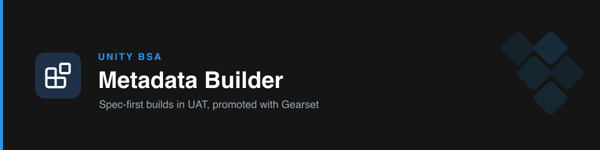

# unity-metadata-builder

Builds Salesforce metadata in the **ironSource UAT sandbox** through the "Beta - Salesforce Grow Admin - UAT" connector: fields, objects, validation rules, permission sets, global picklists, page layouts and assignments, and Flows. Promotion to production stays in **Gearset**.

## How it works

1. **Spec gate:** an ISITBA story and a design, plus an understanding check. Nothing is built from one sentence.
2. **Reuse recon:** suggests existing fields, flows, subflows and permission sets. Suggestions, not blocks.
3. **Flow review:** `unity-flow-reviewer` zero-tolerance pass and at least 85/100.
4. **Build Plan:** one screen; the analyst types `approve build plan`.
5. **Build:** every payload is scanned, every change is read back. The connector can't do something → the manual Setup steps, then verification.
6. **Hand-offs:** QA scenarios and a Gearset component list.

## Guardrails (plugin hook, `hooks/hooks.json`)

- Metadata writes only on UAT, after an Organization query through the same connector.
- No Apex, no Process Builder or workflow rules, no profile permissions, no Active flows in a payload.
- Every flow DML element has a fault path to `Subflow_Log_Error`.
- No `sf` deploys and no git branch/commit/push in the Salesforce org repo: Gearset only.
- Record writes outside UAT are blocked while this skill is running.
- The rules, scripts and hooks can't be edited from a session; changes go through a PR.

Tests: `python3 -m unittest discover -s plugins/unity-bsa/skills/unity-metadata-builder/scripts -p 'test_*.py'`

## Triggers

build flow, create field, custom object, validation rule, permission set, FLS, picklist value, page layout, layout assignment, list view, build in UAT.

## References

- `references/spec-gate.md`: story, design, inventory and understanding check
- `references/reuse-recon.md`: read-only queries for reuse suggestions
- `references/build-plan-template.md`: the approval screen
- `references/connector.md`: the exact connector call for each type
- `references/metadata-standards.md`: rules per type, with sources
- `references/manual-paths.md`: Setup steps and verification queries
- `references/handoff-templates.md`: QA, Gearset and lead consult
- `references/release-notes-watchlist.md`: Summer '26 / Winter '27 items that change how we build
- `config/policy.json`: build orgs, thresholds and blocked types
